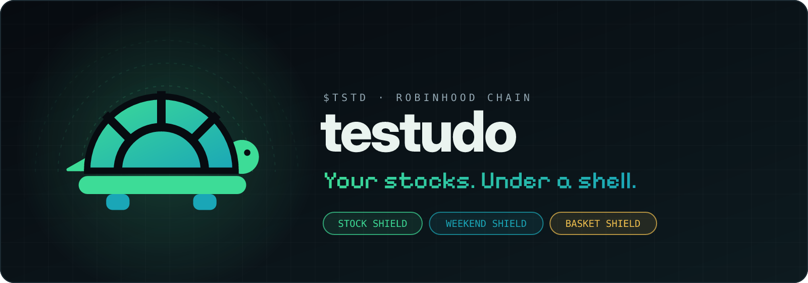
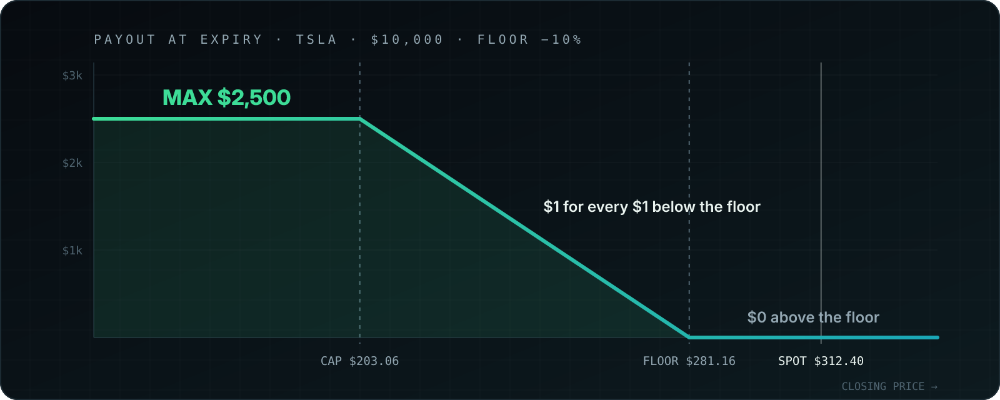
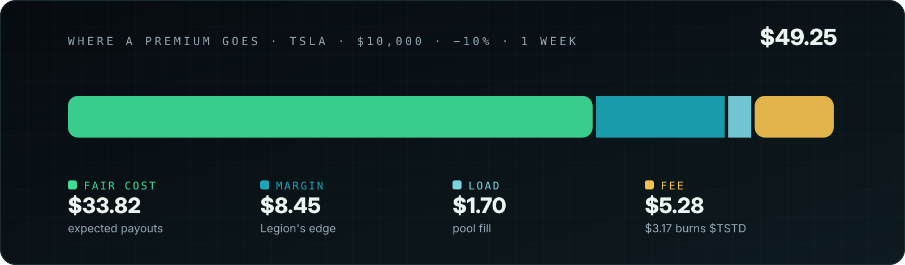

<div align="center">



<br>

**Downside protection for tokenized stocks on Robinhood Chain.**<br>
Pick a floor, pay a premium, and get paid automatically if the price closes below it.

<br>

[](https://testudotrade.com)
[](https://x.com/Testudo_rbh)
[](https://testudotrade.com/token.html)


[How it works](#-how-a-scutum-works) · [Pricing](#-pricing) · [Settlement](#-settlement) · [The Legion](#-the-legion) · [Ranks](#-ranks) · [Try it](#-try-it)

</div>

---

## 🐢 What is Testudo

Tokenized stocks trade around the clock. The exchange behind them does not. A stock can gap down over a weekend, overnight or on earnings while you hold it.

Testudo sells a **Scutum**, a shield on a stock position. You keep your shares. If the price finishes below your floor, the shield pays the difference, up to a cap, from a pool called the **Legion**. A price oracle settles it. You never file a claim.

This repository is the **reference model** behind the quote demo on [testudotrade.com](https://testudotrade.com): pricing, payouts, the pool and holder ranks, in plain Python with tests that check it against the numbers published on the site.

> [!NOTE]
> Shields are not on sale yet. This is a model, not a deployed contract or an offer to insure a position.

---

## 🛡 How a Scutum works

| | Step | What happens |
| :---: | --- | --- |
| **1** | **Pick a shield** | Choose the stock token, how far it can fall before the shield pays (the floor) and for how long. |
| **2** | **Pay the premium** | One payment in USDC. The price follows the stock's volatility, the floor and the term. $TSTD holders pay less. |
| **3** | **Get paid automatically** | At expiry the oracle reads the price. If it closed under the floor, the difference is sent to your wallet. |



A floor of −10% on a $312.40 stock sits at **$281.16**. The shield pays nothing above that, pays $1 for every $1 below it, and stops at the cap: **25% of the position**. A $10,000 shield never pays more than **$2,500**, so every policy has a known worst case.

### Three shields

| | Shield | Term | Built for |
| :---: | --- | --- | --- |
| 🟢 | **Stock Shield** | 1 week or 1 month | One position you want to keep through a rough patch |
| 🔵 | **Weekend Shield** | Friday close → Monday open | The gap while the market is shut but the token still trades. Priced at 1.35× volatility |
| 🟡 | **Basket Shield** | 1 week or 1 month | Several names at once, with the notional split equally |

Floors closer than **−5%** are not sold: they pay so often that the premium approaches the payout.

---

## 📈 Pricing

A shield is a **capped put spread**. Its fair cost is what the pool expects to pay on average. The pool's margin, a load for how full the pool is and the protocol fee go on top.



<details>
<summary><b>The formula</b></summary>

<br>

```text
fair     = shares × [ Put(floor) − Put(cap) ]     Black–Scholes, zero rates
margin   = 25% × fair                              the Legion's edge
load     = fair × utilization × 12%               rises as the pool fills (demo pool: 42%)
fee      = 12% × (fair + margin + load)           protocol
discount = −tier% × (margin + load + fee)         $TSTD holders; never touches the fair cost
premium  = fair + margin + load + fee + discount  and at least $1
```

The fee is about 11% of a full-price premium. **60% of it buys $TSTD and burns it.** The other 40% pays for oracles, keepers and development.

</details>

**The closer the floor, the higher the price.** TSLA, $10,000, one week:

| Floor | Chance it pays | Premium |
| :---: | :---: | ---: |
| −5% | 27.5% | $180 |
| −10% | 10.2% | $49 |
| −15% | 2.4% | $8.60 |
| −20% | 0.3% | $1 min |

**Jumpier stocks cost more.** $10,000, floor −10%, one month:

| Stock | Volatility | Premium |
| --- | :---: | ---: |
| SPY | 16% | $2.34 |
| AAPL | 26% | $37 |
| NVDA | 48% | $242 |
| TSLA | 58% | $363 |

Every figure in both tables is checked by `tests/test_pricing.py`.

---

## ⏱ Settlement

| Shield | Settles on |
| --- | --- |
| Week and month | The close of the last trading day |
| Weekend | The first oracle update after Monday's open |

- **No claims desk.** Anyone can trigger settlement once it is due.
- **A stale price waits.** If the feed is old or missing, nothing pays until a valid price arrives.
- **No insuring a falling knife.** A shield activates a few hours after purchase, and Weekend Shields stop selling at Friday's close.

---

## ⚔ The Legion

The pool on the other side of every shield has two ranks.

| Rank | Funded by | Earns | Takes losses |
| --- | --- | --- | --- |
| **Front: first-loss** | $TSTD stakers | 2× weight on pool income | First |
| **Rear: senior** | USDC liquidity providers | 1× weight | Only after the front rank is used up |

> [!IMPORTANT]
> **Coverage limit.** The pool stops selling once a 30% drop in every covered stock at the same time would ask for more than it holds. Because of the cap, a 30% drop on a −10% floor costs the pool 20% of notional, not 30%.

---

## 🏛 Ranks

Holding $TSTD cuts the margin, load and fee. The fair cost is never discounted, so the pool always gets what the risk is worth.

| Rank | $TSTD held | Off the fee stack |
| --- | ---: | :---: |
| Civis | 0 | 0% |
| Legionary | 1,000,000 | 15% |
| Centurion | 5,000,000 | 30% |
| **Legatus** | 20,000,000 | **50%** |

<sub>These are the reference balances the quote demo uses. Live thresholds are published after launch.</sub>

---

## 🧪 Try it

You need Python 3.11 or newer. There is nothing to install.

```bash
git clone https://github.com/0xGarryLi/testudo_rbh.git
cd testudo_rbh
python -m unittest discover -s tests -v
```

Price a shield from the command line. This one is a week on $10,000 of TSLA with a −10% floor, for a Centurion holder:

```console
$ python -m testudo TSLA 10000 --floor 0.10 --term week --balance 5000000
TSLA  1 week  floor -10%  Centurion
  spot         $312.40
  floor / cap  $281.16 / $203.06
  fair         $33.82
  margin       $8.45
  load         $1.70
  fee          $5.28   burn $3.17
  discount     $-4.63
  premium      $44.62
  max payout   $2,500.00
  chance pays  10.2%
```

Symbols: `TSLA` `NVDA` `AAPL` `AMZN` `MSFT` `SPY` `COIN` `HOOD` · Terms: `weekend` `week` `month`

### What's inside

```text
testudo/
├── pricing.py      fair value, premium, burn, baskets, the $1 minimum
├── settlement.py   payout shape, stale oracle, start delay, Friday cutoff
├── legion.py       double-weight income, first-loss absorption, coverage limit
├── tiers.py        which rank a balance falls into
├── market.py       reference prices, volatilities and protocol parameters
└── __main__.py     the command-line quote
tests/              23 tests pinned to the numbers on the site
```

---

## 🗺 Roadmap

| Phase | | Status | What ships |
| :---: | --- | --- | --- |
| **0** | **Launch** | Now | $TSTD on Pons, the website, the quote demo, X and this repository |
| **I** | **Stock Shield** | Next | Shields on five stocks, Legion pool v1 and oracle payouts, on a testnet first |
| **II** | **Weekend & Basket** | Later | Gap cover, baskets, holder tiers and first-loss staking |
| **III** | **Legion** | Later | Open pools per stock, Senate votes and an SDK for apps |

---

<div align="center">

**[testudotrade.com](https://testudotrade.com)** · **[@Testudo_rbh](https://x.com/Testudo_rbh)**

<sub>MIT licensed. $TSTD is a community token with no promise of profit. Testudo policies are smart-contract agreements, not regulated insurance. Nothing here is financial advice.</sub>

</div>
